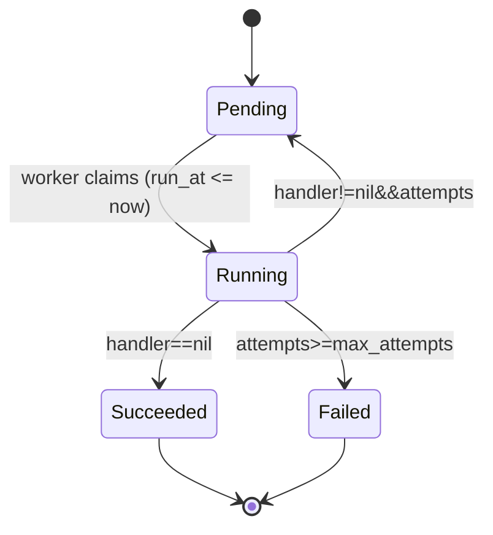

# kiln

Kiln is a simple, reliable distributed task queue for Go, backed by MySQL.
Put tasks in, workers fire them, and failed ones get retried.

> ⚠️ Work in progress — not production ready yet.

## Features (planned)

- Presistent tasks stored in MySQL
- Concurrent workers with safe task claiming (`SKIP LOCKED`)
- Automatic retries with backoff
- Lease-based recovery for crashed workers

## Roadmap

-[ ] v0.1 - enqueue, claim, worker pool, ack, retry
-[ ] v0.2 - lease recovery, fencing, graceful shutdown
-[ ] v0.3 - delayed tasks, metrics, benchmarks

## License

MIT

## Design

### Task lifecycle

