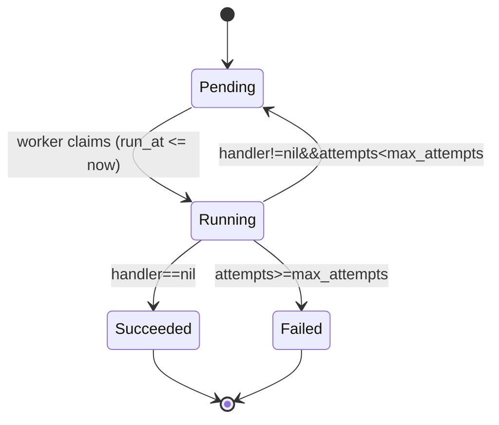

# kiln

Kiln is a simple, reliable distributed task queue for Go, backed by MySQL.
Put tasks in, workers fire them, and failed ones get retried.

> ⚠️ Work in progress — not production ready yet.

## Features (planned)

- Presistent tasks stored in MySQL
- Concurrent workers with safe task claiming (`SKIP LOCKED`)
- Automatic retries with backoff
- Lease-based recovery for crashed workers

## Roadmap

-[ ] v0.1 - enqueue, claim, worker pool, ack, retry
-[ ] v0.2 - lease recovery, fencing, graceful shutdown
-[ ] v0.3 - delayed tasks, metrics, benchmarks

## Requirements

- Go 1.24+
- MySQL 8.0+ (needs `FOR UPDATE SKIP LOCKED`)

### DSN

kiln stores and compares all timestamps in **UTC**. Your DSN must include
`parseTime=true` and set the session time zone to UTC:

```
user:password@tcp(127.0.0.1:3306)/kiln?parseTime=true&time_zone=%27%2B00%3A00%27
```

`time_zone=%27%2B00%3A00%27` is the URL-encoded form of `time_zone='+00:00'`.
Without it, MySQL defaults such as `CURRENT_TIMESTAMP` use the server's local
time zone while kiln writes UTC, and retries can be delayed by hours.

## Development

### 1. Create the database and table

```sql
CREATE DATABASE kiln;
USE kiln;
SOURCE migrations/001_create_tasks.sql;
```

### 2. Run the tests

Integration tests read the DSN from `KILN_TEST_DSN` and are **skipped** if it
is not set (a skipped test still prints `PASS`, so check for `--- PASS` lines).

PowerShell:

```powershell
$env:KILN_TEST_DSN = "root:<password>@tcp(127.0.0.1:3306)/kiln?parseTime=true&time_zone=%27%2B00%3A00%27"
go test -p 1 -v ./...
```

bash:

```bash
export KILN_TEST_DSN="root:<password>@tcp(127.0.0.1:3306)/kiln?parseTime=true&time_zone=%27%2B00%3A00%27"
go test -p 1 -v ./...
```

> Use `-p 1`: tests in different packages share the `tasks` table and clear it
> with `DELETE FROM tasks`, so they must not run in parallel.

## License

MIT

## Design

### Task lifecycle

