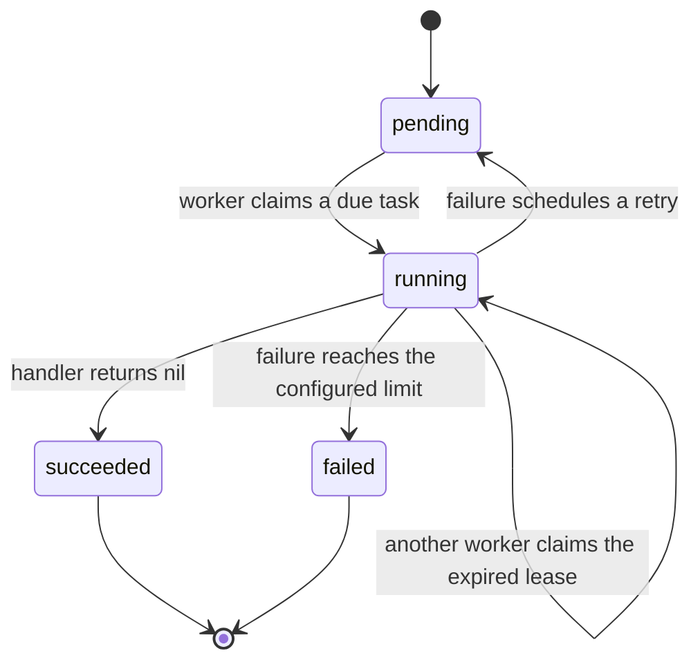

# Kiln

**English** | [简体中文](README.zh-CN.md)

Kiln is a MySQL-backed distributed task queue written in Go. Worker pools claim and execute tasks concurrently, retry failures with backoff, and reclaim unfinished tasks after their leases expire.

Kiln is under active development.

## Features

- Persist JSON tasks in MySQL and schedule their earliest execution time with `run_at`.
- Claim tasks in a transaction using `FOR UPDATE SKIP LOCKED`, so workers can skip rows locked by other transactions.
- Retry handler failures with exponential backoff and mark tasks as failed once they reach the configured failure limit.
- Grant a 30-second lease when a worker claims a task and renew it every 10 seconds while the handler runs. A worker that reclaims an expired task gets a fresh lease token.
- Require a valid lease token for renewal and for recording success or failure. Stop a worker pool by cancelling its handler contexts and waiting for workers to exit.

## Task lifecycle



An unfinished task stays in `running` after pool shutdown and becomes eligible for reclaim when its lease expires. Handlers can run more than once across lease handoffs. Use idempotent operations for external side effects.

## Run the demo

Requires Go 1.24+ and MySQL 8.0+.

### 1. Create a dedicated test database

From the repository root, open the MySQL client with `mysql -u root -p` and run the migration.

```sql
CREATE DATABASE kiln_test;
USE kiln_test;
SOURCE migrations/001_create_tasks.sql;
```

### 2. Set the test DSN

Use a dedicated database because the tests clear the `tasks` table. The DSN enables `parseTime` and sets the session time zone to UTC. The encoded value `%27%2B00%3A00%27` represents `'+00:00'`.

**PowerShell**

```powershell
$env:KILN_TEST_DSN = 'root:<password>@tcp(127.0.0.1:3306)/kiln_test?parseTime=true&time_zone=%27%2B00%3A00%27'
```

**Bash**

```bash
export KILN_TEST_DSN='root:<password>@tcp(127.0.0.1:3306)/kiln_test?parseTime=true&time_zone=%27%2B00%3A00%27'
```

### 3. Run the worker tests

```sh
go test -v -count=1 -timeout 2m -run '^(TestE2E_MixedResults|TestWorker_HeartbeatPreventsDuplicateClaim|TestWorker_ReclaimsTaskAfterLeaseExpires)$' ./internal/worker
```

- `TestE2E_MixedResults` starts two workers and checks that three enqueued tasks reach success or terminal failure, including retries.
- `TestWorker_HeartbeatPreventsDuplicateClaim` verifies that a long-running task remains leased past its original expiry and a second claim finds no eligible task.
- `TestWorker_ReclaimsTaskAfterLeaseExpires` stops one worker, waits for its lease to expire, and verifies that a second worker reclaims the same task. The first worker's token is rejected for success and failure updates, and the second worker completes the task.

The demo takes about one minute. Check that all three tests print `--- PASS`.

Run the full suite with the same DSN. Use `-p 1` because the MySQL and worker packages share the test table.

```sh
go test -p 1 -v -count=1 -timeout 3m ./...
```

## Benchmark

A local MySQL 8.0.46 run with one worker completed 5,000 queued tasks in 44.83 seconds (111.54 tasks/s). See the [benchmark record](docs/benchmark.md) for the setup, timing, and error counts.

## Roadmap

- Metrics
- Benchmarks across worker counts

## License

[MIT](LICENSE)
