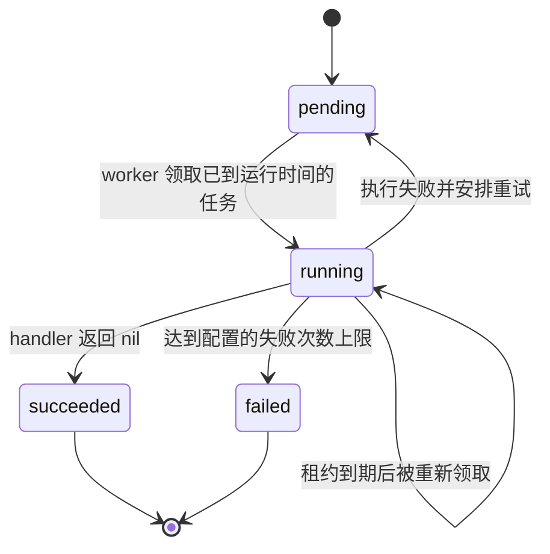

# Kiln

[English](README.md) | **简体中文**

Kiln 是一个用 Go 编写、以 MySQL 为存储的分布式任务队列。多个 worker 可以并发领取并执行任务，执行失败后按退避策略重试，租约到期后可重新领取未完成的任务。

项目目前处于开发阶段。

## 已实现功能

- 将 JSON 任务持久化到 MySQL，并通过 `run_at` 指定任务最早可领取的时间。
- 在事务内通过 `FOR UPDATE SKIP LOCKED` 领取任务，跳过其他事务已经锁定的记录。
- handler 执行失败后按指数退避重试，达到配置的失败次数上限后将任务标为 `failed`。
- 领取任务时发放 30 秒租约，handler 运行期间每 10 秒续租。租约到期后重新领取会获得新令牌。
- 续租及写入成功、失败结果均需要有效的租约令牌。关闭 worker 池时取消 handler 的 context，并等待 worker 退出。

## 任务生命周期



worker 池停机后，未完成的任务保持 `running`，租约到期后才能被重新领取。任务接管后可能再次执行，handler 写入外部系统时需要保证操作幂等。

## 运行演示

需要 Go 1.24+ 和 MySQL 8.0+。

### 1. 创建专用测试库

在仓库根目录使用 `mysql -u root -p` 打开 MySQL 客户端，执行迁移。

```sql
CREATE DATABASE kiln_test;
USE kiln_test;
SOURCE migrations/001_create_tasks.sql;
```

### 2. 设置测试 DSN

测试会清空 `tasks` 表，请使用专用测试库。DSN 通过 `parseTime` 启用时间解析，并将会话时区设为 UTC。`%27%2B00%3A00%27` 是 `'+00:00'` 的 URL 编码值。

**PowerShell**

```powershell
$env:KILN_TEST_DSN = 'root:<password>@tcp(127.0.0.1:3306)/kiln_test?parseTime=true&time_zone=%27%2B00%3A00%27'
```

**Bash**

```bash
export KILN_TEST_DSN='root:<password>@tcp(127.0.0.1:3306)/kiln_test?parseTime=true&time_zone=%27%2B00%3A00%27'
```

### 3. 运行 worker 测试

```sh
go test -v -count=1 -timeout 2m -run '^(TestE2E_MixedResults|TestWorker_HeartbeatPreventsDuplicateClaim|TestWorker_ReclaimsTaskAfterLeaseExpires)$' ./internal/worker
```

- `TestE2E_MixedResults` 启动两个 worker，检查入队的三个任务是否成功或在重试后进入最终失败状态。
- `TestWorker_HeartbeatPreventsDuplicateClaim` 验证长任务跨过初始截止时间后仍持有有效租约，另一次领取找不到可领取的任务。
- `TestWorker_ReclaimsTaskAfterLeaseExpires` 停止第一个 worker，等租约自然到期，验证第二个 worker 重新领取同一个任务。旧令牌无法写入成功或失败结果，第二个 worker 能正常完成任务。

演示约需一分钟。请确认三个用例都打印了 `--- PASS`。

运行全套测试时沿用同一个 DSN。MySQL 和 worker 两个包共用测试表，所以通过 `-p 1` 串行运行。

```sh
go test -p 1 -v -count=1 -timeout 3m ./...
```

## 路线图

- 指标
- 基准测试

## 许可证

[MIT](LICENSE)
