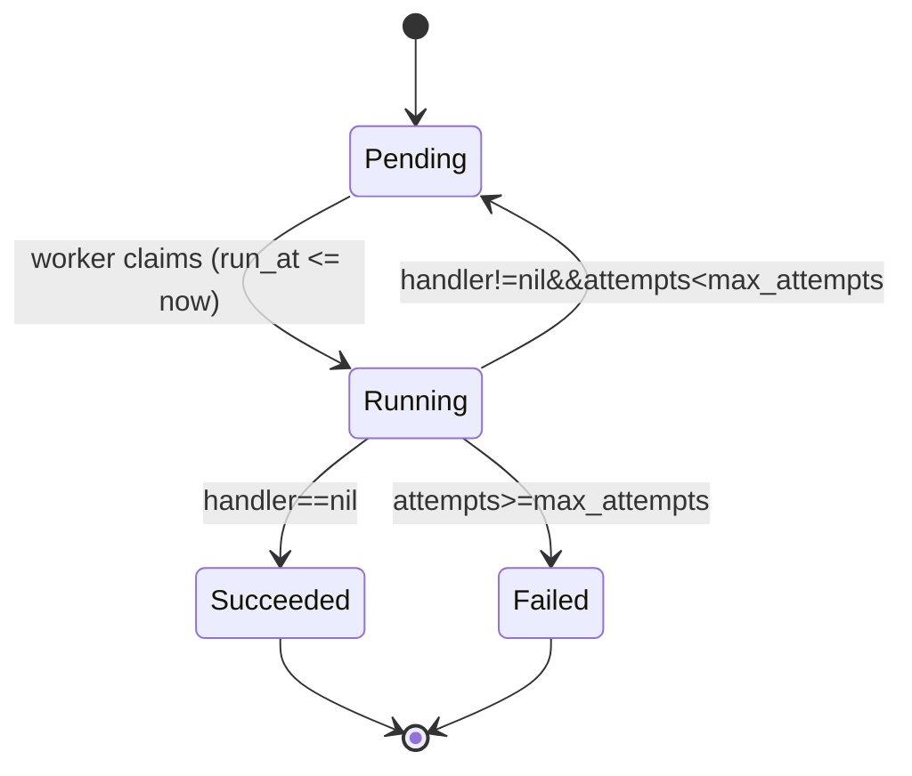

# kiln

[English](README.md) | **简体中文**

kiln 是一个用 Go 编写、基于 MySQL 的简单可靠的分布式任务队列。
把任务放进去，worker 负责执行，失败的任务会自动重试。

> ⚠️ 开发中，尚未达到生产可用。

## 功能（规划中）

- 任务持久化存储在 MySQL 中
- 多个 worker 并发安全地领取任务（`SKIP LOCKED`）
- 失败自动重试，带退避
- 基于租约（lease）恢复崩溃 worker 的任务

## 路线图

- [ ] v0.1 - 入队、领取、worker 池、确认、重试
- [ ] v0.2 - 租约恢复、fencing、优雅关闭
- [ ] v0.3 - 延时任务、指标、基准测试

## 环境要求

- Go 1.24+
- MySQL 8.0+（需要支持 `FOR UPDATE SKIP LOCKED`）

### DSN

kiln 所有时间都以 **UTC** 存储和比较。DSN 必须带上 `parseTime=true`，
并把会话时区设为 UTC：

```
user:password@tcp(127.0.0.1:3306)/kiln?parseTime=true&time_zone=%27%2B00%3A00%27
```

`time_zone=%27%2B00%3A00%27` 是 `time_zone='+00:00'` 的 URL 编码形式。
如果不设置，MySQL 的 `CURRENT_TIMESTAMP` 等默认值会使用服务器本地时区，
而 kiln 写入的是 UTC，重试可能会被推迟好几个小时。

## 开发

### 1. 创建数据库和表

```sql
CREATE DATABASE kiln;
USE kiln;
SOURCE migrations/001_create_tasks.sql;
```

### 2. 运行测试

集成测试从环境变量 `KILN_TEST_DSN` 读取 DSN，未设置时会被**跳过**
（跳过的测试也会显示 `PASS`，请确认输出里有 `--- PASS` 行）。

PowerShell：

```powershell
$env:KILN_TEST_DSN = "root:<password>@tcp(127.0.0.1:3306)/kiln?parseTime=true&time_zone=%27%2B00%3A00%27"
go test -p 1 -v ./...
```

bash：

```bash
export KILN_TEST_DSN="root:<password>@tcp(127.0.0.1:3306)/kiln?parseTime=true&time_zone=%27%2B00%3A00%27"
go test -p 1 -v ./...
```

> 使用 `-p 1`：不同包的测试共用 `tasks` 表，并会执行 `DELETE FROM tasks` 清空它，
> 所以不能并行运行。

## 许可证

MIT

## 设计

### 任务生命周期


