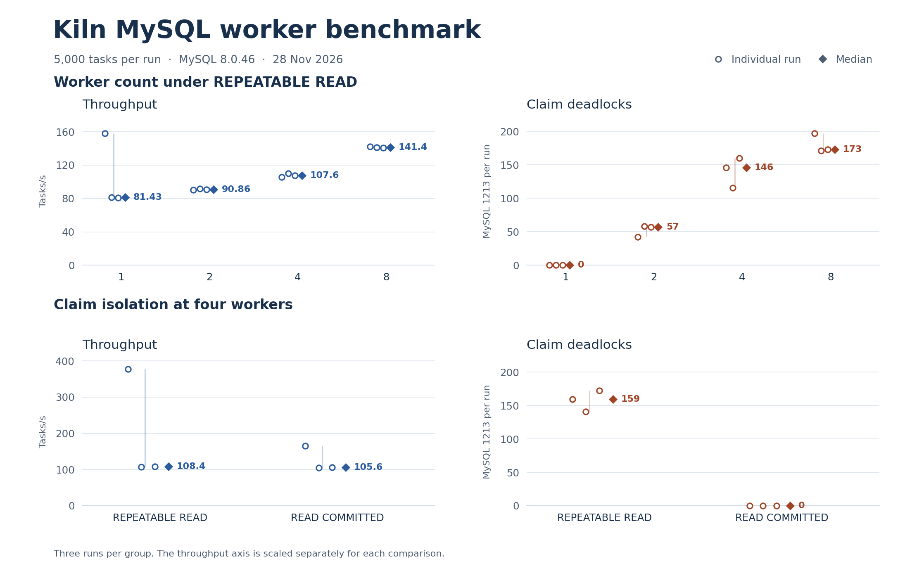

# MySQL worker benchmark · MySQL worker 压测



Open circles show individual runs. Diamonds and labels show the median for each group.

空心圆表示单轮结果，菱形和旁边的数字表示各组中位数。

## Three-run comparison · 三轮对照

Run on 2026-11-28 at revision `7e6c20f` with Go 1.27.0 on Windows amd64 (Intel Core Ultra 9 185H). All 12 batches ran sequentially on the same local MySQL 8.0.46 instance, grouped by worker count. MySQL used `REPEATABLE-READ`, binary logging, `innodb_flush_log_at_trx_commit=1`, and `sync_binlog=1`.

2026-11-28 在 `7e6c20f` 上测得。环境为 Windows amd64（Intel Core Ultra 9 185H）、Go 1.27.0 和同一个本机 MySQL 8.0.46 实例。按 worker 数分组顺序运行，每档三轮。MySQL 使用 `REPEATABLE-READ`，启用 binlog，`innodb_flush_log_at_trx_commit` 和 `sync_binlog` 均为 `1`。

| Workers / worker 数 | Median tasks/s / 吞吐中位数 | Min–max tasks/s / 吞吐范围 | Claim deadlocks (1213) by run / 各轮领取死锁 |
| ---: | ---: | ---: | ---: |
| 1 | 81.43 | 80.72–158.0 | 0 / 0 / 0 |
| 2 | 90.86 | 90.47–91.81 | 42 / 58 / 57 |
| 4 | 107.6 | 105.8–110.1 | 146 / 116 / 160 |
| 8 | 141.4 | 140.7–142.2 | 197 / 171 / 173 |

All 60,000 tasks reached `succeeded`, with zero success write errors. All 1,120 claim errors were MySQL 1213 deadlocks, counted per failed claim attempt. The task table was empty after the final batch.

共 60,000 个任务成功，成功写回错误为 0。1,120 次领取错误均为 MySQL 1213，按失败的领取尝试计数。最后一轮结束后任务表为空。

Eight workers had the highest median throughput in this session. Single-worker results varied from 80.72 to 158.0 tasks/s. These measurements describe one local run series.

本次 8 worker 的吞吐中位数最高。单 worker 的吞吐在 80.72–158.0 个任务/秒之间波动，结果反映本机这批测试。

### Per-run results · 逐轮结果

| Workers / worker 数 | Run / 轮次 | Time / 耗时（秒） | Succeeded / 成功数 | Tasks/s / 吞吐 | Claim deadlocks / 领取死锁（1213） |
| ---: | ---: | ---: | ---: | ---: | ---: |
| 1 | 1 | 31.65 | 5,000 | 158.0 | 0 |
| 1 | 2 | 61.40 | 5,000 | 81.43 | 0 |
| 1 | 3 | 61.94 | 5,000 | 80.72 | 0 |
| 2 | 1 | 55.27 | 5,000 | 90.47 | 42 |
| 2 | 2 | 54.46 | 5,000 | 91.81 | 58 |
| 2 | 3 | 55.03 | 5,000 | 90.86 | 57 |
| 4 | 1 | 47.28 | 5,000 | 105.8 | 146 |
| 4 | 2 | 45.40 | 5,000 | 110.1 | 116 |
| 4 | 3 | 46.48 | 5,000 | 107.6 | 160 |
| 8 | 1 | 35.17 | 5,000 | 142.2 | 197 |
| 8 | 2 | 35.35 | 5,000 | 141.4 | 171 |
| 8 | 3 | 35.55 | 5,000 | 140.7 | 173 |

## Claim isolation comparison · 领取事务隔离级别对照

Run on 2026-11-28 at revision `876bf9a` on the same Windows and MySQL 8.0.46 setup described above, with row-based binary logging. Each pair ran `REPEATABLE READ` followed by `READ COMMITTED`, with four workers and 5,000 pre-enqueued tasks per batch. The two builds differed only in the isolation passed to `Claim`'s `BeginTx`.

本轮于 2026-11-28 在 `876bf9a` 上完成，沿用上述 Windows 和 MySQL 8.0.46 环境，binlog 格式为 `ROW`。每对先跑 `REPEATABLE READ`，再跑 `READ COMMITTED`，每轮 4 个 worker、提前入队 5,000 个任务。两个构建只改变了 `Claim` 调用 `BeginTx` 时传入的隔离级别。

| Pair / 轮次 | Claim isolation / 领取隔离级别 | Time / 耗时（秒） | Succeeded / 成功数 | Tasks/s / 吞吐 | Claim deadlocks / 领取死锁（1213） |
| ---: | --- | ---: | ---: | ---: | ---: |
| 1 | REPEATABLE READ | 13.26 | 5,000 | 377.0 | 159 |
| 1 | READ COMMITTED | 30.32 | 5,000 | 164.9 | 0 |
| 2 | REPEATABLE READ | 46.67 | 5,000 | 107.1 | 141 |
| 2 | READ COMMITTED | 47.77 | 5,000 | 104.7 | 0 |
| 3 | REPEATABLE READ | 46.11 | 5,000 | 108.4 | 172 |
| 3 | READ COMMITTED | 47.36 | 5,000 | 105.6 | 0 |

All 30,000 tasks reached `succeeded` with zero success write errors. MySQL 1213 occurred 472 times under `REPEATABLE READ` and zero times under `READ COMMITTED`. Median throughput was 108.4 and 105.6 tasks/s, respectively. The first pair varied substantially from the following pairs, so this run series leaves the throughput effect uncertain.

共 30,000 个任务成功，成功写回错误为 0。`REPEATABLE READ` 共记录 472 次领取死锁，`READ COMMITTED` 为 0。吞吐中位数分别为 108.4 和 105.6 个任务/秒。第一对与后两对的吞吐相差较大，这组数据还不足以确定隔离级别对吞吐的影响。

### Reproduce the comparison · 复跑对照

Set up `KILN_BENCH_DSN` as described below, then run this command in PowerShell. The [script](../scripts/bench-claim-isolation.ps1) builds both variants with Go overlays and reuses the worker benchmark. It runs three pairs by default. Pass `-Pairs 1` to run one pair.

按下方说明设置 `KILN_BENCH_DSN` 后，在 PowerShell 中运行。脚本使用 Go overlay 构建两个版本，复用现有的 worker benchmark。默认跑三对，可用 `-Pairs 1` 只跑一对。

```powershell
./scripts/bench-claim-isolation.ps1
```

### Full regression · 全量回归

On 2026-11-28, both variants built from `30452da` passed the full suite on local MySQL 8.0.46 with Go 1.27.0 on Windows amd64. Only the isolation of the `Claim` transaction differed. Each run executed 18 tests with zero skips and zero failures.

2026-11-28 在 Windows amd64、Go 1.27.0 和本机 MySQL 8.0.46 上，以 `30452da` 为基础，只切换 `Claim` 事务的隔离级别。两种配置各实际运行 18 项，通过 18 项，跳过和失败均为 0。

| Claim isolation / 领取隔离级别 | MySQL Store tests / Store 用例 | Worker tests / Worker 用例 |
| --- | ---: | ---: |
| `REPEATABLE READ` | 13/13 (0.300 s) | 5/5 (72.421 s) |
| `READ COMMITTED` | 13/13 (0.277 s) | 5/5 (72.418 s) |

The [Store tests](../internal/mysql/store_test.go) cover enqueue, claim, success, retries, terminal failure, and rejection of expired leases and old tokens. The [worker end-to-end tests](../internal/worker/e2e_test.go) verify that a heartbeat prevents duplicate claims, a stopped worker's task can be reclaimed after natural lease expiry, and the old token is rejected for both success and failure writes. The [worker cancellation test](../internal/worker/worker_test.go) also passed in both variants.

Store 用例覆盖入队、领取、成功、重试、最终失败、过期租约和旧令牌拒绝。Worker 端到端用例确认长任务续租期间无法被重复领取，停机后可在租约自然到期时接管，旧令牌无法写入成功或失败结果。失租取消 handler 的用例也在两组通过。

Apply the [migration](../migrations/001_create_tasks.sql) to a dedicated test database, set `KILN_TEST_DSN`, and run the command below. The tests clear the `tasks` table, and the runner uses `-p 1` because the packages share it.

将 `KILN_TEST_DSN` 指向已应用迁移的专用测试库，再运行下面的命令。测试会清空 `tasks` 表，脚本使用 `-p 1` 串行运行共用这张表的包。

```powershell
./scripts/bench-claim-isolation.ps1 -Regression
```

### Adopted Claim isolation · 正式领取事务

Kiln sets `READ COMMITTED` for each [`Claim` transaction](../internal/mysql/store.go). MySQL uses index-record locks for this locking read at that isolation level, which addresses the observed index-gap deadlock when a task changes status. For deployments with binary logging enabled, use `ROW` or `MIXED` so these transactions use row-based logging. [MySQL isolation levels](https://dev.mysql.com/doc/refman/8.0/en/innodb-transaction-isolation-levels.html)

Kiln 在每个 `Claim` 事务上显式指定 `READ COMMITTED`，让锁定读使用索引记录锁，针对压测中任务状态更新遇到的间隙锁死锁。启用了 binlog 的 MySQL 部署可使用 `ROW` 或 `MIXED`，使这些事务按行记录。

On 2026-11-28, the regular build passed all 18 tests with zero skips on local MySQL 8.0.46. The server default was `REPEATABLE READ` and the binary log format was `ROW`. One four-worker benchmark completed all 5,000 tasks in 15.45 seconds (323.7 tasks/s), with zero claim errors, MySQL 1213 deadlocks, or success write errors.

2026-11-28 使用正式代码在本机 MySQL 8.0.46 上回归，18 项用例全部通过，零跳过。服务端默认隔离级别为 `REPEATABLE READ`，binlog 格式为 `ROW`。单轮 4 worker 压测成功完成 5,000 个任务，耗时 15.45 秒，吞吐为 323.7 个任务/秒。领取错误、MySQL 1213 死锁和成功写回错误均为 0。

With `KILN_TEST_DSN` and `KILN_BENCH_DSN` pointing to separate dedicated MySQL schemas, run the regular build with the following commands. 将两个 DSN 分别指向专用的回归库和压测库，再用以下命令验证正式代码。

```sh
go test -p 1 -v -count=1 -timeout 4m ./...
go test -run '^$' -bench '^BenchmarkWorkerConsumeMySQL$/^workers=4$' -benchtime=1x -count=1 -timeout 4m ./internal/worker
```

## Initial single-worker run · 首轮单 worker 基线

Recorded on 2026-11-28 at revision [`8fd2434`](https://github.com/CL0UD6LOCK/kiln/commit/8fd2434c01e4c525c77c89f2257b81599c98e7fa).

| Metric / 指标 | Result / 结果 |
| --- | ---: |
| Workers / worker 数 | 1 |
| Runs / 测试轮数 | 1 |
| Tasks confirmed as `succeeded` / 确认成功的任务 | 5,000 / 5,000 |
| Elapsed / 消费耗时 | 44.83 s |
| Throughput / 吞吐 | 111.54 tasks/s |
| Claim errors / 领取错误 | 0 |
| MySQL deadlocks (1213) during claims / 领取时的 MySQL 死锁（1213） | 0 |
| Success write errors / 成功写回错误 | 0 |

## Run the benchmark / 运行压测

Create a dedicated MySQL database for the [benchmark](../internal/worker/benchmark_test.go), apply the [repository migration](../migrations/001_create_tasks.sql), and leave the task table empty. Set `KILN_BENCH_DSN` to its MySQL DSN. The benchmark cleans up its tasks after each batch.

为[压测代码](../internal/worker/benchmark_test.go)新建专用 MySQL 库，应用[仓库迁移](../migrations/001_create_tasks.sql)，并保持任务表为空。将 `KILN_BENCH_DSN` 指向该库。每批结束后程序会清理本批任务。

```sh
go test -run '^$' -bench '^BenchmarkWorkerConsumeMySQL$' -benchtime=1x -count=3 -timeout 30m ./internal/worker
```

The command runs three batches of 5,000 tasks each for 1, 2, 4, and 8 workers.

命令分别用 1、2、4、8 个 worker 各跑三轮，每轮 5,000 个任务。

## Method

- Ran on Windows amd64 with Go 1.27.0 and a fresh local MySQL 8.0.46 database initialized with the [repository migration](../migrations/001_create_tasks.sql). Both `innodb_flush_log_at_trx_commit` and `sync_binlog` were set to `1`.
- Enqueued 5,000 tasks through the MySQL store before starting the worker pool. Each handler call immediately returned `nil`. The polling interval was 50 ms.
- Timed from pool startup through the final successful database write. After shutdown, a database query verified the final status of all 5,000 tasks. Normal empty-queue responses were excluded from claim errors.

## 测试方法

- 在 Windows amd64 上使用 Go 1.27.0 和全新的本机 MySQL 8.0.46 测试库，应用[仓库迁移](../migrations/001_create_tasks.sql)。`innodb_flush_log_at_trx_commit` 和 `sync_binlog` 均为 `1`。
- 通过 MySQL Store 预先入队 5,000 个任务。handler 立即返回 `nil`，worker 轮询间隔为 50 毫秒。
- 从 Pool 启动计时到最后一次成功写回。停机后查询数据库确认所有任务状态。队列为空属于正常响应，不计为领取错误。
